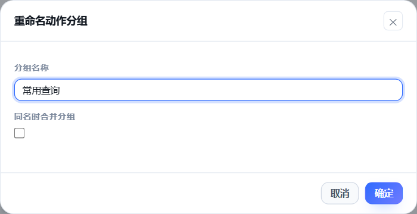

# 动作与工具

[文档目录](README.md) · [按主题拆开的详细说明](GUIDE.md) · [返回 README](../README.md)

> **v3 变化**：动作库已经改成「虚拟动作 / 提示词事件」——动作只影响她的世界与提示词，
> 工具调用交回 AstrBot 原生 Agent，「从工具导入」入口已下线。本文里讲"工具型 / 指令型动作、
> 插件自己调模型执行工具"的段落都是旧版行为，只作历史参考；现在的做法见[根目录 README](../README.md)。

动作的字段含义、批量生成、工具与指令怎么被调用。

## 使用动作库

动作定义角色在虚拟世界里做什么，例如去窗边、读书、泡茶和休息。真实联网、生图等工具由 AstrBot 原生 Agent 调用。

顶部搜索按名称、ID、说明和分组筛选；“新增动作”创建一条，“生成动作”可按人设与地图起草，也可生成通用日常。生成结果先预览，再加入动作库。

左侧按组筛选，右侧显示卡片或列表。卡片开关控制启用状态，点击卡片或按回车打开编辑。内置动作可以停用，不能删除；扩展提供的动作需在对应扩展里管理。批量选择支持一次启用、停用、改分组与删除。

“高级”收纳默认动作维护、JSON 编辑与旧版清理。默认动作初始停用，按需要开启。下方字段参考包含旧版本的工具／指令动作，这些兼容字段不代表新配置需要把真实工具绑定成动作。

## 动作编辑里的每个概念

| 字段 | 含义 |
| --- | --- |
| **动作类型** | 瞬时=立刻完成（说话、抱抱）；持续=占用一段时间（睡觉、看书、上网） |
| **执行层级** | 模板=不调大模型，直接发固定文案（最省钱）；单轮=让大模型说一句（日程 / 计划里的步骤没有现成台词时也会现场生成一句，没模型或额度用完才退回动作文案）；工具型=调用 AstrBot 里已注册的工具 |
| **生效范围** | 全局=任何地点都能做；仅特定地点=只有站在指定地点时才存在这个动作 |
| **限定地点** | 配合「仅特定地点」使用：这个动作属于哪些地点。她不在那儿时它不会出现在她的选项里 |
| **分组** | 动作库里的归类。留空按用途自动归类；也能自己起名字——抽屉里那个下拉列着已有分组，直接填新的也行。动作库左边就是按它筛的 |
| **启用 / 停用** | 停用等于"根本没有这个动作"：不进场景动作表、不进提示词、绑定的工具也不再算、计划里排到就跳过；她正在做的那次会立刻停下 |
| **目标** | 自己/空间、某个群友、整个群。指向人的动作会以动作描述发到群里 |
| **持续时间** | 「固定时长」每次一样；「由大模型决定」把时长交给模型在**最短~最长**之间自己定（例如小睡睡多久），超出区间自动夹住 |
| **执行期间状态标识** | 执行中她的状态（sleeping / reading…），会影响群名片文案与状态判断 |
| **完成时一次性效果** | 做完立刻生效一次，例如「心潮 增加 0.28」；「设为」会直接覆盖当前值 |
| **每持续 1 分钟的效果** | 按实际持续时间累加：小睡写「精力 增加 0.0015」，模型决定睡 30 分钟就 +0.045，睡 60 分钟就 +0.09 |
| **完成后** | 什么都不做 / 让她接着说一句（把结果讲成人话）/ 接着执行另一个日程 |
| **使用的工具** | 只有「工具型」动作才有：至少选一个 AstrBot 里真实注册的工具，也可以选多个（按顺序依次调用）。工具的参数不用你填，运行时由辅助模型按每个工具自己的定义补全 |
| **固定参数** | 工具型动作才有：填过的参数每次都用你写的值，不再交给模型猜。主要用来兜底「工具把参数写成可选、实现却必须要」的第三方工具（例如查天气固定 `city=武汉`） |
| **内置** | 引擎对它有专门逻辑（说话 / 移动 / 睡觉 / 想事情 / 分享 / 回想 / 记住 / 戳一戳 / 日程三件套 / 上网 / 天气 / 生图系列），**只能停用、不能删除**；误删会按默认值自动补回 |
| **亲密程度** | 这一步算多"亲密的肢体接触"（0~1）：做完会按它满足**欲求**（摸摸头、抱抱、亲亲这类）。**留空 = 自动判断**：内置动作查对照表（抱抱 1.0、蹭蹭 0.8、摸摸头 0.7、牵手 0.6、拍肩 0.2…），用户自己新加的动作会问一次便宜模型并记住（动作改了名字或说明才重判），填 0 是明确说"这不算肢体接触"。批量生成动作时也会一起生成它 |

**动作归属只有一份数据。** 地点页面里的「可用动作」和动作里的「限定地点」是同一个字段的两个视图：
在地点里勾上一个动作，动作的限定地点里就会多出这个地点；反过来也一样。全局动作在任何地点都能做，
所以在地点页面里它以「通用动作」只读列出，要改范围就去动作库改。

**扩展带来的动作由扩展自己管。** 装了扩展（独立安装的插件）时，它带的动作会并进动作库
（撞名字的让位给原有动作），在动作库左边的菜单里单独归到「扩展动作」那一截。这些动作
**不写进世界配置**：所以在这儿不能删、也不能停用（开关在扩展自己的那一页），
卸掉扩展它们就一起消失。

## 闲置生活

动作库 → 生成动作 → **按人设生成闲置动作**，读取当前编辑范围的人设与补充要求，生成通用生活细节。草稿确认才保存；这和“生成通用动作”（不参考人设、按地图分配地点）是两个入口。

同一菜单里的“闲置生活设置”默认开启自动轮换，单次 10~30 分钟，缓解强度 0.35。你可以修改开关、最短／最长时长和生成补充要求。关闭轮换立即结束闲置显示。人设生成只在点击按钮时调用模型；平时从动作库选择并按世界 tick 计时，无需再次调模型。

闲置动作会出现在动作库的“闲置生活”分组，可编辑名称、说明、生活影响、次数上限和数值效果，也可停用或删除。作为自动闲置动作必须满足：持续动作、模板层级、无对象、无工具／指令、完成后选“什么都不做”。其名称与说明是当前场景背景，不会发送到聊天。生成动作默认通用，不需要特定地点或物品；手动添加时可限定地点。

空闲时选择一项，并在设置的时间范围内保持，结束后尽量换另一项。正式动作、移动、睡眠优先，闲置动作即时让位；中断不会结算完成效果。只有自然到期会结算手配的一次效果及按分钟效果。闲置生活期间的默认需求缓解还会乘“闲置缓解强度”；手配效果按其实际配置结算。设次数上限可限制一天重复多少次。

闲置动作不会进入模型的正式动作清单或日程动作链，也不会逐次写记忆与发群通知。地图活动浮签、控制台与场景提示词显示此刻的小事；鼠标悬停可阅读完整说明。没有可用闲置动作时显示“自由休息”，不会虚构一项已执行活动。

## 分组重命名

在动作库左侧，点组名旁的铅笔，输入新名字，再点右上角「保存」。内置的自动分类也可以这样命名；改名会为组内动作保存明确的分组名。

- 更新整组动作，包括已停用、被搜索或条件筛选隐藏的成员。
- 名称不能留空，最多 80 个字符；同名分组只有勾选「同名时合并分组」才会合并。
- 不改变动作 ID、工具参数、地点绑定和日程引用；扩展动作的分区由扩展自己维护。

## 工具完成后的回答

全局「工具结果续说」是兜底：同一串动作中，工具后面已有当前会话的回答时，不再额外生成一遍。
如果动作明确配置了「完成后由大模型续说」，会以实际工具结果生成回答，并替换同轮工具前预写的回答；
续说失败或没有产出时，仍保留预写回答。工具前的「等我查一下」不受影响，跨会话的发言也不合并。

## 默认动作按需启用

随插件附带的默认动作（唱歌、抱抱、看书、做饭……）从 v3.5 起**默认停用**；
新世界只保留说话 / 移动 / 睡觉 / 想事情 / 分享 / 回忆 / 记住 / 碰一碰这几个核心动作。
这样动作库和提示词都从干净状态开始，需要哪些就打开哪些：

- 单张卡片：左上角开关；
- 批量：筛选「只看已停用」→ 勾「批量选择」→ 全选 → 启用；
- 一键：动作库「高级 → 启用默认动作…」；也可以用「停用默认动作…」一次收回。

老配置第一次加载时会自动迁移一次：只停用随插件附带的默认动作，
你自己加的动作和核心动作保持原样；迁移之后你再打开的动作不会被重新关掉。

## 用大模型批量生成

生成入口（用的是插件配置里的「**内容生成模型**」，运行时完全不调用）：

| 入口 | 生成什么 | 上限 |
| --- | --- | --- |
| 生成地点 | 给这个区域添几个地点（名称 / 描述 / 氛围 / 图标 / 颜色） | 一次默认 3、最多 8 |
| **按人设与地图生成动作**（在**动作库页头**） | 读她的人设 + 整张地图，按地点分布生成一批**虚拟动作**；可以指定总数量 | 一次默认 8、最多 24 |
| **生成通用动作**（在**动作库页头**） | **不看人设**，写一批普通人过日子都会做的小事（散步、泡茶、听歌、晒太阳…）；地图可选参考——参考就按地点绑好，不参考就生成完由插件铺到地点上 | 一次默认 12、最多 24 |
| 生成动作（在**地点属性**里） | 照着这个地点（以及它所属的区域）写几条能做、又值得在群里讲一句的动作 | 一次默认 3、最多 5 |
| 批量生成动作（在**区域属性**里） | 给这个区域里的**每个地点各**生成几条动作，走同一套弹窗勾选 | 每个地点默认 3、最多 5 |

生成结果**不会直接落库**：会先弹出一个列表，每条都能改名字、改归属地点、删掉，还可以只勾其中几个；
点「确认加入选中的」会**直接保存并生效**（不用再点右上角「保存」）。

- **动作库页头的新入口**会带上人设、全部区域与地点、已有动作（防重复），并要求模型把动作分散到
  不同地点；生成的动作只绑地点、不挂工具（工具调用走 AstrBot 原生 Agent）。它写不出合适动作时
  会在弹窗里说明，确认前可以改名、调地点、勾选或删掉。
- 地点 / 区域里的旧入口同样先弹预览；生成的动作默认绑到它所属的地点，同名 id 会自动加后缀。
- 生成地点时会自动摆位（接在已有的地点旁边，不会重叠），并按**方案 A** 连线：
  第一个新地点连到区域内最近的一个既有地点，之后依次串成链，默认 1 tick（都在预览里可见、可改）。

## 把工具一键导入成动作

工具多的时候，一个个手建动作很费时间。动作库页头的 **「从工具导入…」** 把这件事变成一次点击：

1. **挑工具**：搜索、按来源（官方 / 具体插件）筛、`全选` / `清空` / `只选未导入`，
   也可以只勾一两个；已经做成动作的工具会标出来。
2. **自动填好所有字段**：名字取工具说明的第一句（不够就用工具名）、说明沿用工具作者那份、
   分组默认按来源分（`官方工具` / `插件工具 · 某个插件`）、参数按工具的 JSON Schema 列出来。
3. **可选：让内容生成模型起名**——「命名方式」选"让内容生成模型起名"时，它会按她的人设
   把工具起成"她会说出口的那件事"，并把一批工具归到几个好找的分组里；失败自动退回规则命名。
4. **先预览再导入**：预览会列出每个动作的名字 / 分组 / 工具 / 参数 / 说明，
   以及被跳过的工具和原因。
5. **导入即生效**：导入会直接写盘并热加载（不用再点保存）。

导入的只是**起点**，不是终点：导入后照常在抽屉里改名字、改说明、绑地点、加固定参数、停用或删除。
几个约定：

| 情况 | 行为 |
| --- | --- |
| 工具或提供它的插件已停用 / 卸载 | 不出现在导入列表；全选也不会导入。窗口打开后失效的工具会在提交时跳过并提示 |
| 已导入的动作后来失去对应工具 | 保留动作配置，不执行已停用或未注册的工具；可用「只看缺工具」筛选检查 |
| 工具已经做成动作 | 默认**跳过**（不会重复建）；把「重复的工具」换成"覆盖已有的那个动作"就按最新说明重写那一份 |
| 工具是「直接把消息发到会话」那种 | 默认跳过并给出理由：它会绕过回复管线（分段、表情包、发送前钩子都会失效） |
| 工具声明了参数 | 参数由辅助模型在运行时补全，不用你填；抽屉里那张参数表可以给单个参数点「固定」，钉死成固定值（例如天气的 city） |
| 一整批工具都想挂上 | 勾「全选」再导入即可；动作 id 自动加 `tool_` 前缀并去重 |

## 工具是怎么被调用的

**参数补全什么时候触发**：只要工具声明了参数、而这次没给全，就会让辅助模型补一次
（不只是"缺必填"时）。如果调用时报「缺少参数 / 参数不匹配」这类错，插件会带着报错再补一次并**重试一次**，
所以「schema 里写着可选、代码里其实必须要」的第三方工具也能跑通。
每个工具的原始必填列表可以在「调试」页看到。

**参数不需要你手写，也不需要主模型一次写全。** 调用分两步：

1. 她（主模型）只输出**意图**——「查一下今天有什么科技新闻」，用自然语言说清想干什么；
2. 插件拿这个意图 + 工具自己的参数定义（名称、类型、说明、是否必填），
   交给**辅助模型**（插件配置里的 `helper_provider_id`）翻译成参数字典，再用 schema 校验一次，最后真正调用工具。

这样主提示词不用塞进所有工具的 schema（否则又长又不准），填参数时模型也只需要盯住一个工具。
同一个「工具 + 意图」会命中缓存；每小时有次数上限（全局设置 → 说话频率与预算 → 每小时最多补全工具参数次数）。

你要做的只是**在动作里选好「用哪个工具」**——工具只挂在动作上，不再需要在节点里配一遍。
没选工具的工具型动作会被跳过，日志里会写明原因；选了但 AstrBot 里没注册，同样跳过。
工具结果默认会交回主模型，让她用自己的话说出来（可在「全局设置 → 工具」里关掉）。

**结果里的图片也认得出来**：工具或指令返回 `event.image_result(...)` 这类带图的消息时，
插件会把图单独挑出来——配了转述模型就先转述成文字，没配就直接交给多模态主模型一起看，
返回文字则按组件还原（文本、`@某人`），不会把一串 `MessageEventResult(chain=[...])` 的对象表示丢给模型。
**这些图还会被贴出来**（生图插件就是这样接的）：她的话先发出去，图跟着发一条，
一次出好几张就放在同一条消息里，最多 9 张；转述成不成功都不影响发图。
**图跟着她那句话的落点走**：私聊里让她拍照，图就发在私聊；群里起的就是发群里——
一个会话组里几个群 / 私聊共用一份状态，图和正文分家过一次（文字进私聊、图发到群里），
所以现在两者用的是同一个落点，落点实在定不下来时会按当前会话发并记一条警告日志。

**日程里的落点规则另有几条**：日程里勾了会话组 = 由她在组内**挑一处**说，不会整组广播；
勾了多个具体会话 = 这条日程只执行一次（动作链不重复跑），文本和图片**发到全部选中的会话**；
组和具体会话混着勾时，保存时会归一化成只留组，并在响应里给一条 warning。
日程动作里写出的越界 `send_to`（不在「你能说话的地方」名单里）会被**忽略那一句并记下原因**，
不会改发到主目标；非日程场景的 `send_to`（比如她自己决定「去群里说声晚安」）还是老规矩：
拿定主意那一刻就定死。
「指令触发」型动作和工具型动作走同一套规则：动作里的「完成后」与全局的「工具结果回话」都关掉时，
执行完就安静，不会再强行说一句。

**它是怎么把指令跑起来的**：插件从 AstrBot 的指令注册表里按名字（含别名）找到那个处理器，
借用这条会话最近一条真实事件、把消息文本临时换成指令本身，再按 AstrBot 自己的规矩解析参数
（**参数类型取 AstrBot 解析好的那份**，所以插件用 `from __future__ import annotations`
写的注解、以及 `GreedyStr` 这类特殊参数都能正确还原）。处理器 `yield` 出来的文本与图片会收起来
交回给她说一句。指令跑挂时会记一条「指令「…」没跑成：…」，**并带上最后出错的文件:行**——
报错来自别的插件时，一眼能看出是谁的问题。

**一个动作可以挂多个工具**，用「工具用法」决定它们怎么配合：

| 用法 | 行为 | 什么时候用 |
| --- | --- | --- |
| 按顺序都调（默认） | 装了的都调一遍，结果合并 | 确实要串起来，例如先搜索、再抓正文 |
| 依次尝试 | 只用一个：按顺序挑第一个能用的，失败换下一个 | 同一个意思装了好几个工具，互为备份 |
| 智能选择 | 让辅助模型按她的意图挑一个（挑工具与补参数一次完成） | 工具用途差别大，靠名字分不清该用哪个 |

选择器按来源分组（官方 · 搜索 / 官方 · 其它 / 插件 · 具体插件名），可以搜索、
**用下拉只看某一组**、折叠、全选本组。后一个工具补参数时，会把前一个工具查到的内容一起给补全模型，
所以「先搜网址、再抓正文」这种链条不用你手填参数；中间哪个工具缺必填参数，只会跳过它自己并写进日志。
工具越多每一步越慢、也越容易失败，只在确实需要配合时才挂多个。

**工具坏了会被临时停用**：同一个工具连续两次「调用不出去」（没注册 handler、报错、超时、连接断开）
就进入退避——30 秒起、每次翻倍、最长 30 分钟，期间不再尝试它。参数写错、结果为空不算坏，不会触发。
退避到期自动放行试探一次，成功就清零；改配置（重载）会全部解除，
「控制台 → 互动与运行」里也能看到被停用的工具与剩余时间，点「重试」立刻解除。

内置的「上网搜索」「查天气」**不带任何默认工具**——工具可以在动作里挑，
但**天气已经不需要你挑了**：后台静默刷新和她的「查天气」都会自己从 AstrBot 已注册的工具里
认一把天气工具（名字或说明里带 weather / 天气，例如 uapipro 工具箱的 `uapi_weather`）；
连「查天气」这个动作被删掉，后台刷新也照样能用。搜索动作没挑、或者挑了没装的工具时，
这一步会被跳过，日志与编辑器横幅里会写明是哪个动作缺工具。

v3 的主回复走 AstrBot 原生 Agent：这一轮能调用哪些工具由 AstrBot 自己的工具清单决定，
本插件**不再裁剪、也不再把「通用工具」塞进提示词**。上面说的动作绑定工具只属于 v2
旧动作层——只有在迁移期重新打开 `legacy_tool_actions` 时才会被旧版动作使用；
设置页已经不再展示「工具」这一栏。

**工具写法兼容**：AstrBot 里的工具有三种实现方式——`@filter.llm_tool` 的 `handler`、
新版工具的 `call()`（MCP 工具、很多第三方插件都是这种）、以及老的 `run()`。
插件按同样的优先级依次尝试，所以「没有可调用的 handler」这种报错只会出现在
三种入口都没有的坏工具上。返回 MCP 风格的 `CallToolResult` 时也会把里面的文本取出来，
而不是把整个对象塞给模型。

**官方内置工具也在列表里**：编辑器里带「官方 ·」前缀的就是 AstrBot 自带的内置工具
（`web_search_tavily` / `web_search_bocha` / `web_search_brave` / `web_search_baidu` /
`web_search_firecrawl` / `web_search_exa` / `web_search_anysearch`、配套的网页正文抓取、
知识库检索、定时任务、电脑操作等）。它们不在 AstrBot 的插件工具列表里，是单独存放的，
插件把它们一起列了出来，所以不用为了搜索再装一个第三方插件——**直接把 AstrBot 里已经配好的
联网搜索绑到动作上**就行（工具的说明里带自己的参数定义，参数依旧由辅助模型补全）。

注意：`send_message_to_user` 这类「直接发消息」的工具会被标成不可用——它绕过本插件的回复管线
（发送前插件、表情包识别、分段回复都会失效），所以不参与动作；没配 key 或没启用的官方工具
调用会失败并写进日志，不会让流程卡住。

### 联网检索

工具型动作有一个「调用形态」。默认的「直接调用」是把工具结果原样交回给她；
选「**联网检索**」就走一条查资料专用的流水线，适合「上网搜索」这类动作：

1. **她要查什么**：动作里写 intent 就行；要分角度查时还能一次给 1~3 条 `queries`
   （例如「今日热点新闻」和「某某事件 最新进展」）。她只写了意图、没给查询词时，
   由辅助模型把意图翻成一条能直接丢进搜索框的查询词。
2. **结果整理成证据**：搜索工具返回的 JSON、一行行带链接的文本、或者一大段散文，
   都会被归一化成带编号的条目（标题、链接、摘要、时间），去重后最多留 8 条——
   她能对着编号讲，日志里也看得出「这句话是照哪条说的」。原文永远完整留在日志与工具结果里，不截断。
   搜索工具常见的排版是「标题一行、`- **URL**:` 一行、**摘要一行**」——
   摘要那一行会被正确接上（以前只留了 `**URL**` 三个字母，于是"搜到了却说什么都没查到"）。
3. **读正文（可选）**：在「阅读网页工具」里选上能把网址换成正文的工具后，
   插件只挑**看着像某一篇**的链接抓正文（每篇最多 1200 字，同一篇 6 小时内不重复抓）：
   首页 / 栏目页（`…/tech/index.shtml` 这种）不读，抓回来是导航页或 `extract_failed` 的也不当正文，
   会换下一篇候选（多备一个）。一条像正文的都没有就不读，直接用搜索摘要。
   读到导航页时**材料会退回搜索摘要**，不会把好摘要一起挤掉。
   有的阅读工具返回的是 JSON 外壳（`{"url":…,"title":…,"content":…}`）：会先把 `content` 取出来，
   再去掉整行的导航链接（``），所以材料里不会出现字段名和转义换行；
   社交 / 问答站（facebook、x 这类）也算入口页，不去读。
4. **不够就补查**：证据太少时，让辅助模型换个角度再给一两条查询词，按「检索深度」决定补几轮。
   补回来的词和已经问过的**同一个意思换个说法**（「更新公告」／「更新内容」／「前瞻回顾」）时会被丢掉，
   不再拿同一批结果重搜一遍；换了角度的问题照查。
5. **她照着证据讲**：提示词里只有证据块，规则是「证据里没有就直说没查到、不许编数字和时间、
   别照抄原文、别念网址」。整条流水线（多条查询 + 读正文 + 补查）最多花 20 秒，超时就用手上已有的证据。
   压成要点时喂进去的是「正文（像正文时）或搜索摘要」，最多 10 条 / 每条 400 字；
   压缩真写不出东西（「材料里没有直接答案」）时，直接改用手上的证据块，不拿那句当结论。

「检索深度」三档：**快查**只查一轮、不读正文也不补查；**标准**（默认）读前两篇、最多补查一轮；
**深挖**至少读三篇、最多补查两轮。

自定义动作也能用这个形态：把「搜索主题」写清楚（例如「今日新闻热点」），
或者用「查询模板」套格式（`{date} 新闻热点`、`{topic} 最新消息`）。
优先级是：她写的意图（含日程里写的那句）> 搜索主题 > 查询模板 >
**让她自己想一句**（规则触发时问一句"你现在想查什么"，带上她此刻的位置/状态和群里最近聊的事）>
中性兜底主题（「今天有什么新鲜事」）。

**规则触发也能有像样的意图**：好奇心、日程这类不是大模型安排的检索，本来没有"她自己的意图"，
现在会按上面的顺序补上——配了主题就用主题，没配就让她照着当下处境和群聊话题自己想一句
（这一步算在「每小时最多自主发言文案」的额度里，没额度/没模型时才退到中性主题）。
配了主题的好处是稳定、还省一次调用；不配的好处是话题会跟着群里正在聊的事走。

**为什么兜底不用动作说明**：说明写的是"这个动作怎么用"（例如「上网查东西（在书房用电脑）」），
拿它当"要查什么"，补参模型只能自己编一个"全球新闻 + 天气 + 比分"式的万能查询，
搜出来全是聚合站和应用商店。规则触发（好奇心、日程）时没有她自己的意图，
所以这类动作**建议配一个搜索主题**；不配也不会再退化成那种万能查询。
另外生成查询词时会额外要求：关键词 20 字以内、只查一件事、不要写成「获取……的最新信息」这种句子。

**来源去哪了**：默认只写进日志与调试输出（`🔗 检索来源`，调试输出里默认不勾选，不会发到群里）；
想让她的回复末尾带一条参考链接，就把「讲结果时带来源」打开。

### 一次检索是怎么收敛的

检索不是"她说一句、查一次"，而是一段**在插件内部跑完**的流水线（学网页版那套做法）：

1. **谁来决定查什么**：她自己写的意图 → 动作里配的「搜索主题」→ 查询模板 →
   让她按当下的处境和群里的话题自己想一句 → 中性兜底（「今天有什么新鲜事」）。
2. **她可以说要查多深**：动作输出里可以写 `queries`（几条查询）、
   `search_depth`（quick / standard / deep）和 `read_pages`（读几篇）。
   **动作里配的是上限**——她只能往浅里调，不能超过配置。
3. **查完先压成要点**：读回来的正文由打杂模型整理成「结论 + 编号要点」再交给她，
   而不是把一堆原文丢过去（材料本来就很少很短时跳过这一步，不浪费调用）。
4. **够了就停**：证据够用（至少两条、其中一条有像样的正文）就不再补查；
   补查一轮之后如果一条新东西都没多出来，也直接停——不会为了一个查不到的词反复换词搜。
5. **刚查完这一轮不再接检索**：续说那一轮她想再写一次搜索也会被拦下（日志里记一条「续说这一轮不再接…」），
   只剩"说话"。动作链条太深时，工具 / 指令型动作同样会被拦下。
6. **上一轮查过什么会带进下一轮提示词**（一小时内的检索会写成一段「最近查过」），
   免得她隔一轮又用同样的词查一遍。

**回显合并**：一次检索里查了 3 条、读了 2 篇，群里只会看到两三行——
**调试行是"发生时就发"的**（不再等整轮动作跑完才一起推）：每次工具调用一行
`🔧 调用「anysearch_search」参数 {...}`，同一工具的连续调用（一次检索并行查好几条）
按防抖只发一行；返回同样是 `📥 「anysearch_search」返回：…`。
细节仍然完整留在「日志」页。打开「精简模式」时只留 `🔧 调用「anysearch_extract」`（不带参数）。

**她要说的话也是"发生时就发"的**：慢动作（联网检索、生图、录视频）开始之前她已经说出口的那几句
（「坐好等我两分钟～」）当场发出去，不再等整段流水线跑完才和结果一起冒出来。
真的发出去的那几句才算"她说过"（进日志、进聊天记录、计入被动回复额度）；发送失败的那句不算，
它会留在这一轮收尾的剩余消息里按原顺序再试一次（平台整个不通时这一轮自然都发不出去），
收尾那次只发剩下的，也不会再引用触发她的那条消息；`say` 排在慢动作之后时行为不变。

**要不要再来一轮由主模型判断**：每轮结束时会把手上的结果和已经查过的词交给主模型，
它说够了就停、并进入"按材料说话"那一步；它说不够就给出 1~2 条新查询词再来一轮
（受动作里配的「最多补查几轮」限制）。返回不可解析、或者只给出已经查过的词，一律停。

**挂了多个搜索工具**：检索形态下只有**第一个能用的**会被当成搜索入口；
它要是坏了（没有 handler、超时、连接断开…），插件会把剩下的候选取来接着查同一条查询。
要抓正文请在下面的「阅读网页工具」里单独配。

## 关于「直发消息」的工具

AstrBot 内置了 `send_message_to_user` 这类直接把消息发给当前会话的工具。
**本插件不会调用它们**——走这条路会绕过 AstrBot 的回复管线（发送前插件、表情包识别、
分段回复、合并转发都不会命中），还容易重复发言：

- 插件自己的动作解析工具时会跳过它们，自动匹配也绝不选中，日志里会写明原因；
- 编辑器的工具列表里它们带 ⚠ 提示；
- v3 不再裁剪原生 Agent 的工具清单：本插件既不添加、也不移除 `send_message_to_user`
  这类工具；它们是否可用、会不会被调用，由 AstrBot 的原生工具策略和模型决定。

判定收得很紧：只有名字**整个**就是对已知的那几个直发消息工具（去掉插件名前缀之后）才算，
名字里带"出图 / 视频 / 语音 / 文件"这类词的（`send_image`、`image_plugin.send_message` …）
一律放行——出图工具被误判挡掉时，图只能等别的路径补发，落点会跟着跑偏。

模板文案支持三个占位符：`{bot}`（她自己）、`{user}`（动作目标群友）、`{node}`（当前地点），
例如 `（{bot}抱了你一下）`。
