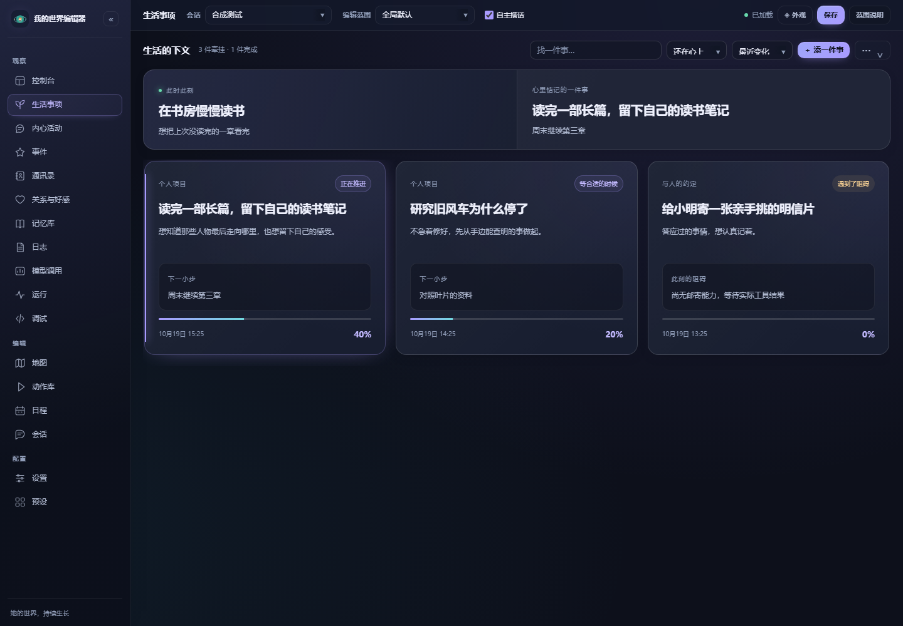

# 生活事项与持续推进

[文档目录](README.md) · [自动生活](autonomous-life.md) · [返回首页](../README.md)

她可以记着一件想做的事，隔几天继续，而不是每次空闲都重新想一个故事。**生活 → 牵挂** 展示动机、实际步骤、下一步与阻碍；点击卡片，在侧边查看经过和管理操作。

## 一件事怎样继续

例如，她想用一周读完一部小说。模型先按现有动作和地点安排一批小步：今天读开头，明天继续，周末再读一段。每批最多六步，每步通常五至六十分钟，可以安排到三十天内。

只有实际运行完的活动才增加步骤进度。有人来聊天、日程到点或需要休息时，她可以先放下；中断前已经投入的分钟数会保留，下次只做剩余部分。精力、作息、关键事件、可达地点和当天投入上限共同决定能否继续。

准备新项目小步或新的自主安排时，先共用一套准入判断：眼前的重要事件、已经开始的休息或手头工作、十分钟内的日程、当前精力，再考虑新事项。符合执行条件的事项中，约定优先，同类按最久未尝试的顺序轮换。生活页会显示当下取舍理由。已有日程和事件仍由各自执行器推进，这不是对所有入口统一抢占的调度器。

在线投入逐拍保存，同一段时间只计一次；跨午夜时分别计入对应日期的额度。某件事用完当天额度或规划次数后，先让其他符合条件的事项继续。取消、临睡、过劳休息，以及删除或停用正在用的动作，都保留此前实际投入，不会因此把整步标成完成。

做完一批步骤后，先核对实际记录：整个目标已达成就结束；还需要继续就安排下一阶段；能力不足就记下阻碍。后续规划保留已完成步骤和依据，不会重新抽样改写这些经历。卡片以“已进行几步／已安排几步”展示进展，细线只表示当前步骤比例，不能当作整个目标的精确达成度。尚无可执行步骤时不显示百分比。

复核还可以留下一段具体的 **阶段笔记**：写出的草稿、推演思路或未解问题，以及下阶段从哪里继续。它引用有投入记录的已完成步骤，明确标为世界内模拟；后续规划读取当前目标的笔记，沿着具体内容继续。改目标后，之前的笔记保留为历史，不作为新目标的阶段所得。每项最多八段、每段正文最多一千二百字，复用现有复核调用。

项目和承诺不会仅因过了几天而消失。一时的念头，以及迁移过来且还未开始的旧打算，可以按原有保留天数淡去；记录会明确写“尚未确认完成”。

## 打算从哪里来

- 对话复盘可以记下一件自己的打算，或对当前说话人的约定。
- 管理者可以点击“添一件事”写下项目、约定或念头。
- 开启“空闲时会自己产生个人打算”后，她积累至少六小时生活时钟、清醒且有空、没有正在推进或待接续的事项时，每天最多提出一个新的个人项目。等待条件和已暂停事项不会一直占住生活。允许没有想法，不会为了填满看板不断建任务。

模型临时不可用或返回格式有误时，会等至少十五分钟后再尝试，同时遵守“再次推进间隔”，一天最多尝试三次；重启不会清掉次数。明确回答“没有新想法”就到此为止，当天不再反复追问。

等待自发打算返回时，如果切换人设、重新载入世界配置、调整生活归属或停用会话，旧结果会放弃。返回时已经准备休息、开始忙别的事或有了其他未结束事项，也会暂缓；保留尝试次数和重试间隔，不算当天已经成功产生想法。回合复盘同样会核对人设与世界，避免旧判断影响切换后的角色。

共享生活组可以共用个人项目；涉及具体人的约定只在来源会话展示和提供给对话。QQ 统一关系起点与各会话独立关系发展仍按原规则运行。

## 做过什么，与做成什么

安静的持续活动使用当前已启用、地点可达、条件满足的兴趣或探索动作。编程、创作、整理收藏等个人项目也可以使用 **AI 模拟**：她在自己的世界里投入时间、遇到困难、逐步完成，而插件只保存文字经历。关闭自主搭话时，生活仍能安静推进。

模拟活动与普通活动一样分成小步，遵守睡眠、精力、重要事件、日程、暂停和每日投入限制。只有在线时钟推进才累计时间，规划本身不增加进度，离线也不补演工作。没有配置可选兴趣动作时，仍可在当前地点进行模拟活动。

模拟内容会在步骤、历史和生活记忆中标注，不执行代码、读取服务器文件、创建电脑环境或生成可下载文件。阅读活动仍只证明世界内阅读；通用模拟活动不会被误计成阅读等具体兴趣。

对现实用户的发照片、寄东西、购买等约定，模拟只能完成世界内准备，仍需聊天中的真实兑现依据或管理员确认结果。失败、一句口头声称或布尔完成标记都不能自动兑现约定。QQ 的实际工具调用与电脑能力由 AstrBot 原生 Agent 处理。

暂时无法生成合适安排时，会保留事项并延后再想，遵守规划次数和后台预算。受阻事项不会挡住其他生活。

取得依据并确认兑现后，会停止这件事尚未结束的准备动作与计划，保留已投入时间；不会因此打断别的事项，也不会被旧动作的收尾重新打开。

“确认结果…”允许管理员填写结果并手动完成，也可选择放弃；历史会标出人工调整。改目标会保留已做步骤，并重新安排后续。页面还能查看相关记忆和模型调用。

改目标会清除上一目标的阶段核对等待，避免旧阶段被当作新目标的完成依据；暂停的事项恢复或延期后会重新占用活跃名额，达到上限时需要先放下其他事项。

## 日子怎样留下变化

“生活积累”位于顶栏“···”菜单，展示多日活动经验、世界内阶段记录与今日后台用量。实际活动至少跨三个不同日子、累计三次且四十五分钟，才成为后续空闲选择和新打算的参考。记录包含日期、时段与地点；同一时段在至少三个日期重复后，可向模型提供温和的节奏参考。近期投入按七天半衰加权，同一星期几至少三次可形成周节奏提示，三十天未再出现则淡出；“今日”中可以展开查看依据。

普通持续活动和安静闲置也能积累，不必绑定项目。在线投入逐拍保存；被打断后保留已做部分，完成时只补记未计入的部分。同一段活动只计一次，跨午夜或早晨、白天、晚间、夜间的边界分别归档。前往地点的移动、睡眠和外部操作不会被当作个人练习，离线也不会增加投入。

**原有人设始终是言行的主要依据**。活动投入不等于喜欢；经验只能在符合原有性格、价值观、喜恶和当前条件时延伸日常习惯，不能改变身份、口癖或关系权限，也不强迫每次重复同一种活动。

阶段记录只描述实际活动。物品、穿搭等外部状态继续使用现有状态槽，以真实工具结果为准，不会自动创造新物品。

## 节奏、预算与暂停

在“··· → 节奏与预算…”调整后，点击编辑器顶栏“保存”写入当前配置范围。

| 设置 | 默认行为 |
| --- | --- |
| 自动推进生活事项 | 开启；关闭后保留事项，不再自动安排下一小步，已经开始的活动继续收尾。要立即停下可暂停该事项。 |
| 空闲时产生个人打算 | 开启；可单独关闭，已有事项仍可继续。 |
| 活跃事项上限 | 六件，避免生活变成排满的任务单。 |
| 每件事每天最多投入 | 九十分钟，可分多次完成。 |
| 再次推进间隔 | 六十分钟；手动继续可重新评估。 |
| 后台每日调用预算 | 一百二十次；零为不限制次数。 |
| 后台每日 Token 预算 | 零，默认不限制；可按实际用量设上限。 |
| 后台同时模型请求 | 默认一个；后台工作按全局并发设置排队，各角色的工作都有等待位置。已有显式设置保留。 |

预算跨重启保留，涵盖经过引擎后台通道的规划、复盘、整理等调用。正常交互回复有独立路径；编辑器内容生成同样经过后台生成通道并计入预算；可选嵌入请求有各自的调用记录，不计入此后台预算。Provider 未提供完整 Token 时保留保守占位，和实际用量分别展示；估算不是账单，也不能保证服务商侧绝对不超额。失败会退避，模型不可用时规则仍负责基本生活。

## 重启与离线

恢复时仅做有边界的时间、需求与休息结算，不补演全部活动、不补发历史早安、不虚构离线事项进展。世界时钟最多补二十四小时；按原计划实际睡过的时段恢复精力、降低睡意和积压的好奇，醒后需求最多补算六小时。睡眠结束时刻保留在记录中，不把重新连接的时刻当作刚醒。运行中的普通工作会中断，保留此前在线确认的投入，之后再继续。旧存档没有可靠的最近生活时刻时，首次不猜测停机多久。

不同角色的时钟并行推进。新事项的规划与阶段核对在状态锁外运行，返回后核对事项版本、基础人设、世界配置与生活归属；管理员已暂停、改目标、切换人设、调整生活组或停用时，旧结果不覆盖新安排，已有生活记录保留。其他明确的生活决策也在等待模型时释放状态锁，基本时钟继续；返回后检查日期、角色、设置和当前状态。真实工具与指令执行仍保持顺序，不会为重试而自动重放。

生活经验只证明她实际做过什么，不等于喜欢。三十天没有再次出现的活动倾向不再用于日常参考，多次被打断可以建议拆短小步。生活页“日子留下的东西”可查看近期日期来源，也能清理某条活动经验，原始生活记录保留。
