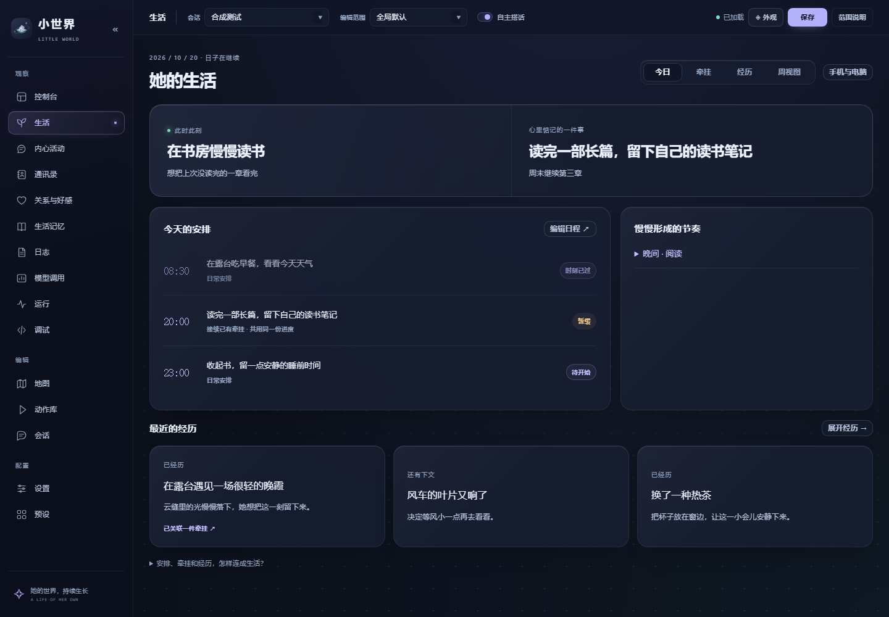

# 生活：安排、牵挂与经历

[文档目录](README.md) · [自动生活](autonomous-life.md) · [生活事项](life-matters.md)

打开编辑器的 **生活**，就能看她此刻在做什么、今天怎样安排、心里还惦记着什么。日程、生活事项和事件在同一个入口里相互关联，各自的编辑、生成、记录和管理能力都保留。

点击 **生活页顶栏的「手机与电脑」** 可开启 [安静翻消息](chat-browsing.md)，设置符合人设的设备、会话来源和读取量。三个视图都能直接打开。它是低频日常活动；今日显示正在浏览，感想和折叠来源放在内心活动，不另增页面，也不会主动发消息。

手机上采用单列布局，管理操作收进抽屉：[手机预览](images/life-workspace-mobile.png)。图中均为示例资料。

## 三个视图怎样用

| 视图 | 展示什么 | 常用操作 |
| --- | --- | --- |
| 今日 | 当前活动、今日安排、近期经历，以及有实际依据的生活节奏。 | 点安排查看关联牵挂；“编辑日程”打开完整日程管理。 |
| 牵挂 | 想跨天继续的项目、念头和约定，保留动机、下一步与阻碍。 | 搜索、筛选、排序；点卡片暂停、延期、改目标、安排时间或确认结果。 |
| 经历 | 生活中发生的事、选择、结果与尚未结束的线索。 | 查看每一幕，继续或结束线索；“投递与事件设置…”管理生成和发生规则。 |

日程管理里可以新增、编辑和生成安排，设置自动排程，查看执行记录。事件管理里保留手动投递、生成草稿、自动事件设置与原有配置。管理抽屉内可选择编辑范围并保存设置，关闭后回到原来的生活视图。

## 它们有什么区别

- **日程回答“什么时候做”**。例如每天晚上八点留半小时阅读，或者明天下午继续画画。
- **牵挂回答“为什么还想继续”**。例如读完一部长篇、学会一首曲子，记录跨天进度。
- **经历回答“途中发生了什么”**。例如读书时想到一个问题、散步遇到晚霞，可以留下后续，也可以自然结束。

一次阅读日程可以接续已有的读书事项，共用同一份进度。中途的重要事件可以让她先放下书，已投入时间仍保留。遇见晚霞后，如果她确实产生了想画下来的动机，可以留下一个念头；普通经历不会被强制转换成任务。

## 给牵挂安排时间

在牵挂详情点 **安排时间…**，选择日期和时间；也可以在日程管理的 **到点做什么** 中选择已有牵挂。到点接续它的下一小步，不再执行另一套重复动作链。普通吃饭、散步或提醒仍可单独使用动作链。

事项暂停、条件未满足、达到每日投入限额、等待真实兑现，或正在休息时，不会因为预约就自动做完。自动安排会依规则暂缓，达到重试上限后记为今天放下。手动立即执行可以主动调整当前安排，但仍遵守事项自身条件和额度。

## 阶段笔记怎样继续使用

创作与学习在阶段复核时，可以留下具体草稿、推演或未解决的问题。点开牵挂卡片，在 **阶段笔记** 中查看内容与下一阶段的切入点；后续规划会读取这些内容，接着写或继续思考。

笔记必须引用已经执行、有投入记录的步骤。计划中的步骤和不存在的编号不能作为依据，同一步也不会反复产生阶段笔记。这些内容属于角色世界内的 AI 模拟，不代表查证了真实资料、操作了服务器或生成了可下载文件。复用阶段复核请求，每项最多保留八段短笔记。

## 生活怎样接得上

重要事件、日程和休息使用共同的取舍规则。需要中断时先结算事项已投入的时间，记录原因；条件合适后可以继续原步骤。未过期、地点和角色设置仍一致的安全安静计划可自动恢复；明确取消的计划不会复活，工具、指令和发言步骤不会自动重放。

“慢慢形成的节奏”来自不同日期的实际投入。近期记录权重更高，同一星期几多次出现可形成周节奏参考，三十天没有再出现的倾向淡出。展开即可看依据。这些经验服从原有人设，不会把“经常做”直接当作“喜欢”，也不要求填满空闲。

后台生活决策等待模型时释放状态锁，让基本时钟继续推进。返回后核对日期、人设、世界、日程、生活归属和当前状态，已经变化的决定会作废。真实工具或指令执行仍需顺序完成，避免取消后重复副作用；离线期间不补造工作成果。

生活事项中的编程、创作等个人活动使用 **AI 模拟**，只形成角色世界内的文字经历，不操作服务器或新增电脑环境。QQ 聊天中的原生 AstrBot 能力保持原有方式，见 [插件联动](integration.md)。
