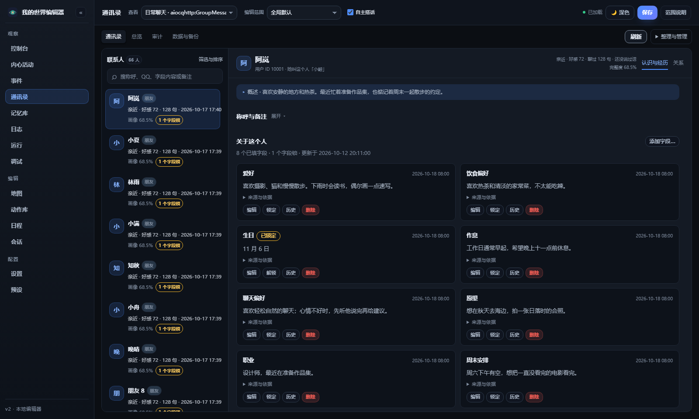

# 记忆与通讯录

[文档目录](README.md) · [按主题拆开的详细说明](GUIDE.md) · [返回 README](../README.md)

## 四类资料各自负责什么

| 资料 | 记录什么 | 在哪里管理 |
| --- | --- | --- |
| 生活记忆 | 她经历的活动、事件、长期事项的实际进展、当时的内心和梦 | 生活记忆 |
| 人物资料 | 人物事实、详细画像、称呼、字段、备注和关系依据 | 通讯录 |
| 关系与好感 | 各会话的好感、身份、相处距离及互动习惯 | 关系与好感 |
| 群词典 | 群里的专用词、共同用语与原话依据 | 生活记忆 → 会话词典 |

人物资料保留从 [心迹画像 Profile Weaver](https://github.com/Whereis-Alice/astrbot_plugin_profile_weaver) 集成的自动提取、字段维护、来源与审计、字段锁、工具、备份和增量同步能力。它回答“这个人是谁”，与聊天往事检索职责不同。群词典仍会自动学习，也可人工维护；只有当前会话的词被命中时才作为参考。

My World 不保存长期聊天摘要，也不滚动压缩聊天窗口。聊天长期记忆可由 Anamnesis 负责。短期窗口仍供当前回复、人物资料提取和关系判断使用；超出上限的旧消息移出窗口，不会自动变成生活经历。

## 生活记忆怎样形成

实际完成的活动、事件经过、内心变化与长期事项的执行收据进入生活库。打算留在生活事项中，只有执行后才产生进展；真实工具操作必须有工具结果，不能把一句“我去做”记成已经完成。

梦使用独立类型，召回时明确标作“梦境，非现实经历”；内心记录也有标记。梦和猜想不能证明用户说过什么、答应过什么，经历只能在原有人设上温和延伸，不能改写身份、性格或价值观。

睡眠整理分两条独立路径：合格聊天原话只更新人物事实、关系和速写；已发生的生活经历才可被合并、折叠或联想成梦。两条路径不共享模型输入，输出也分别校验。固定的记忆不可被自动折叠或因容量自动清理，人工修改后的旧整理结果会作废。预览可看每个阶段的提示词与结果，不写业务数据。

与具体用户约定的私人事项，推进后留下的生活记忆只在来源会话的相关交谈或主动查询中使用。它们与翻消息产生的感想都不进入共享睡眠整理、自动回访或自主发言的上下文；语义检索也先按相同边界过滤。普通个人项目的生活经历仍可在同一共享生活组中使用。

聊天复盘留下的短期推理和内心活动也标明来源，只在原会话交谈与对应内心页中使用，不成为其他会话或自主生活的动机。清空会话上下文会同时清理本会话的对话草稿和短期感想；清空内心活动保留其他会话的专属条目。没有可靠来源的旧对话草稿不再自动引用，原记录保留；普通生活中的独处想法照常共享。这些短期内容不会另存为聊天长期记忆。

新消息保留来源资格：实际被选入本轮上下文后，才可用于后续人物事实整理。原话、发言人和来源会话以已保存的快照为准，引用或外部回忆不能被重新标成直接发言。来源只能证明引用来自哪里，不能保证模型归纳必然正确。

可见多人发言会分别检索相关生活经历，去重后共用自动召回预算；引用和其他插件的回忆不作为新发言。会话、人格、地点及明确共享范围的限制对主动查询和语义检索同样有效。

共同用语与相处习惯详见 [相处习惯与共同用语](social-learning.md)。

## 可选语义召回

默认使用关键词、人物、地点与时间等信息召回，不需要嵌入服务。希望“换一种说法也能想起”时，在 **生活 → 牵挂 → ··· → 节奏与预算…** 开启语义召回，填写：

| 设置 | 示例与说明 |
| --- | --- |
| 嵌入 API 基址 | `https://你的服务/v1`，支持 OpenAI 兼容 `/embeddings`。 |
| 嵌入模型 | 服务商提供的模型名称，需支持中文。 |
| API Key 环境变量名 | 例如 `MW_EMBEDDING_KEY`；在运行 AstrBot 的服务器设置该变量的值。页面只填写变量名。 |

应用并保存后，相关对话及 `mw_memory_lookup` 主动查询会准备向量，结合原有检索评分使用。实际发送给嵌入服务的是本次查询和允许范围内的候选记忆正文，因此应选择自己认可的服务。先按现有作用域过滤，再请求嵌入；人格共享或全局范围仍遵守你原先选择的规则，不会因启用语义功能自动放宽。

索引保存在原 SQLite 库，可以重建。每次最多补三十二条候选；首次使用或大量旧记录尚未建索引时，语义覆盖会逐步增加。正文改变或切换服务、模型后重新建立相应向量；当前查询的分数短时缓存五分钟。这里没有新增独立向量数据库或重排模型，也不保证召回所有历史。

嵌入失败时保留事实、退回关键词路径并短暂退避。实际嵌入请求和服务返回的 Token 会出现在 **模型调用** 页面，未提供用量仍标未知；嵌入请求不计入后台生活的每日预算。

## 与长期记忆插件配合

在 **生活记忆 → 回忆设置** 选择自动回想生活，或只在主动查询时回想。自动回忆默认最多 1200 字符，包含时间和经历细节；超出预算的完整条目跳过，预算为 0 时停止自动注入及自动回访。人物资料与词典独立工作。

`mw_memory_lookup(topic)` 只查询生活，`mw_profile_lookup` 查询人物资料。聊天往事使用 Anamnesis 提供的工具。My World 不读取、写入或同步对方数据库，也不会改动它已注入的内容。配合方式与预算说明见 [记忆共存说明](memory-compatibility.md)。

## 通讯录的组织方式

通讯录以人物卡片展示称呼、资料摘要、完整度和最近交谈。顶部选择实际会话，点开卡片后在侧边档案中管理资料、备注、共同经历与近期变化，关闭即可回到原来的卡片位置。搜索、筛选与整理工具集中在顶部的小块区域。

好感与关系在独立的 **关系与好感** 页面管理，按 QQ 号汇总。统一设定会更新各会话当前值并保留未来初始值，此后每个会话独立计算；也可展开某个会话单独调整。两页可直接跳转到同一个人的相应档案。

「关于这个人」可点击标题收起或展开；本次打开编辑器期间，切换联系人和刷新资料会保留折叠偏好。收起只影响界面，字段仍参与模型资料合并。

结构化字段是稳定资料的主要来源。旧版将同一字段复制到事实库的记录不再重复展示，底层事实仍保留；没有对应结构化字段的旧事实会继续显示。当前会话字段优先于全局共享字段，其他会话的专属资料不参与合并。

在原生对话中，模型可以主动调用 `mw_profile_lookup`。无参数查当前发送者；`query` 按称呼或 ID 查人，`user_id` 精确定位，`topic` 按话题筛选。结果包含字段、画像备注、关系和经历。同名时只返回候选 ID，模型需要按 ID 再查询。读取不会创建联系人，也不会关闭本轮的信息提取。

「模型可见资料」展示当前联系人作为说话人时的资料预览；实际请求还会带世界状态、相关记忆和本轮消息。画像备注、称呼与摘要都供模型参考，请按这个用途维护内容。

旧画像增量同步按字段记录来源版本。当前插件删除某字段后，重启或旧插件修改无关字段不会重新导入未变化的旧值。旧插件再次修改该字段时，它才成为新的增量来源。

## 通讯录：她认识的人

通讯录回答“这个人是谁、我了解他什么”，关系页回答“我跟他怎样相处”，记忆回答“发生过什么”。原生人物档案、事实、关系与好感按实际会话保存；结构化字段可以选择会话专属或明确全局共享。

关系身份与相处距离独立配置。普通友谊默认按跨日期的直接交谈和好感发展；恋爱、主人等特殊关系默认只允许管理员手动设置，可逐类开启自然形成。每种关系还可配置上下限、是否允许越过通常距离上限、替代组与唯一槽位。

详细设置、十档方案、原话确认与想念规则集中在 [通讯录与关系](relationships.md)。

### 好感度是怎么动的

| 来源 | 默认行为 | 限制 |
| --- | --- | --- |
| 露面 | 每次 +0.05 | 同一人 10 分钟一次，每人每天最多 +2。 |
| 回复后互动评价 | 依据本轮行为及基础人设，通常为零 | 评价每轮最多 ±0.2，再受每轮及每日额度限制；来源去重。 |
| 当场记住 | 按内容及现有校验处理 | 共享每轮 ±3、每人每天增加和减少各最多 10 的额度；睡眠整理不再重复改好感。 |
| 久未交谈 | 正好感向零回落 0.2/天 | 默认最近直接交谈后保留 7 天，每个实际会话每天分别结算。 |
| 负好感缓和 | 每天向零恢复 0.2 | 仍保留已确认关系，不自动解除。 |

这些数值都可在用户画像设置中调整。好感不直接等于身份；分级的禁止动作主要通过提示词让模型遵循。关系页展示限制原因与临时生气造成的距离变化。

想念是独立的联系动机，达到阈值后还需满足开关、作息、冷却和额度。页面显示当前原因，是否开口仍由她决定。

### 她自己动手改画像：内置动作「记住」

事实、关系、好感度**不是只在睡下之后才更新**：她有一个内置动作「**记住**」，
当场就能把这些写进通讯录（和睡眠整理共用同一套写入与校验）：

| 参数 | 说明 |
| --- | --- |
| `user` | 记的是谁（QQ 号）。**只认她真的见过的人**，编出来的号码一律不写 |
| `text` | 一句话说清是什么事 |
| `evidence` | **他的原话**（必填）。没带原话的事实 / 关系一律不记 |
| `kind` | 喜好 / 厌恶 / 习惯 / 基本信息 / 关系 / 约定 / 近况 |
| `bond` | 可选：根据近期本人原话提出关系，受自然形成开关与冲突规则约束 |
| `confirmation` | 特殊身份或唯一关系需要她在同一次交谈中的明确确认原话 |
| `affinity_delta` | 旧式动作可选参数，受好感额度限制；睡眠整理不重复调整好感 |

写法就是普通动作的参数（`{"type":"remember","params":{…}}`），写完不用再说一句——
想顺口提一句就另外写一个 `say`。
「**回想**」也接上了这条：翻出来的旧事里如果关于某个人的信息、或者你们的关系**已经变了**
（称呼变了、喜好变了、约定作废了、亲疏变了），续说那一轮会提示她用 `remember` 把新情况改掉。

**什么时候会被提醒用它**：他说的话里出现"关于他自己"的信息（我是 / 我叫 / 我喜欢 / 我不喜欢 /
我生日 / 以后叫我 / 我住 / 我养 / 我老婆 这类词）时，回复提示词里会专门加一段：
让他把这条用 `remember` 写进通讯录，并给出他的号码和参数写法。
平时不啰嗦——单纯寒暄不会加这一段。

`remember` 更新的是通讯录资料。生活记忆由实际活动、事件和内心记录产生，不能用它另存一份长期聊天摘要。

**看得见她到底记了什么**：日志页的事件类型里有「她主动记进通讯录」
（记下了什么、没记成的原因一起写出来），调试输出里也能单独勾选它。

**「缩略版画像」是画像速写，不是事件流水**：它只写"这个人是谁、怎么说话、喜欢什么、你们什么关系"
这类稳定特征，**不写他最近遇到的事**（那类事可放在「事实 → 近况」，聊天往事由聊天记忆插件负责）。整理模型偶尔会把它写成
"抽卡一发出了角色"这种近况——提示词里已经写明不许这么写；通讯录详情页顶部那一行就是它。

人物卡片和档案各自滚动，档案标题固定可见。事实默认只显示置顶与最近 8 条，其余可展开；关系页单独展示最近的好感变化、关系依据和候选确认，避免与资料编辑混在一起。

### 她记着的账（记仇）

关系表那几条是**长期定性**（讨厌的人 / 敌人，由你配）；记仇是**事件性的、可逆的**：
他做了一件让她气着的事（答应的事又没做、放鸽子、当众让她下不来台、骗了她），她记一笔。

记的账会让她**对这一档冷一档**——不是改关系、也不是扣好感数值，而是把**生效档位**压下去一档
（默认 1 档，可配）：原本能抱抱的"亲近"档，气着的时候退回"朋友"档该有的规矩。
而且这条账**只在跟他说话时**才拿出来，别人面前一个字不提。

几条刻意卡紧的闸：

| 闸 | 默认 | 为什么 |
| --- | --- | --- |
| 同一个人 | 最多 1 笔 | 不叠加：这件事比那件事更气人就换掉 |
| 同时最多几笔 | 2 笔 | 整个会话组算一份，不然她会变成记仇机器 |
| 一天最多记几笔新的 | 1 笔 | 天天记仇的人不可爱 |
| 一笔记多久 | 7 天 | 到期自己淡掉，并写进记忆（「气过一阵就算了」） |

**怎么消**：他道歉 / 补上了 / 解释清楚了 → 那笔账划掉，并留一条她自己的记忆（「跟他算清了一笔账」）；
在 **关系与好感 → 个人卡片 → 展开会话 → 查看关系依据与变化记录** 中，可以手动记下一件事、标为已经释怀或删除记录。这些情绪属于生活状态，共享生活组共同感受；不会把各会话的关系或好感数值改成一样。

提示词里一次最多带 2 条（回话时只有当前这个人的那一条，因为一人只留一笔）。

### 她自己答应过的事

她的打算、项目和约定保存在 **生活事项**，默认同时最多六件活跃事项。事项会跨天保留，不因几天没聊天自动消失；可以暂停、延期、调整或放下。

她结合日程、精力与困意安排下一步，执行后才增加进度。完成准备动作不等于兑现承诺，照片、文件和其他外部操作需要实际结果或管理员确认。见 [生活事项与持续推进](life-matters.md)。

### 睡眠记忆整理

她睡着之后会整理这段经历——就像人睡着时海马把白天的经历搬进长期记忆。节奏是
**一段睡眠最多两次**：睡下 **20 分钟**第一次，睡满 **5 小时**补一次；**不是每 20 分钟轮一遍**。
两个时间点都能在「全局设置 → 记忆与上下文 → 用户画像」里改（补一次填 0 = 只整理一次）。

整理在后台等待模型，不会占住生活时钟或阻止叫醒、查看与修改状态。同一生活同时只整理一轮，手动与自动入口也遵守这一规则。成功次数与重试时间随这一觉保存，重启不会重新计数；失败至少五分钟后再试，不消耗成功次数。真正醒来或开始下一觉后，旧任务未提交的结果会放弃；已经有效提交的阶段仍保留。

人物与生活阶段只有一边成功时，保留成功的部分，稍后只重试失败的部分；不把这一轮当作完整成功，也不重复生成已经提交的梦或资料。

整理分三步：

1. **人物资料**：只从本批合格原话提取事实、关系与缩略版，不把旧记忆或旧画像结论混作新证据；
2. **生活整理**：单独读取已经发生的生活记忆，按已提供的编号合并或折叠，不新增用户事实、不改变好感；保留原来的地点、日期、类型和结果；
3. **遗忘**：只**折叠**（正文换成一句要点，原话进「当时：…」留着），**不删除**。

人物资料按原话记录去重，前后两批有重叠时只提交未整理的新材料；一次最多四百条，未提交的在短期窗口保留期间可由后续整理处理。同一人在群聊和私聊中的速写分别更新，不能明确来源时不写。小睡处理过速写后，整觉仍可从这些原话提取事实和关系；整觉已处理的原话不会再单独触发小睡速写。模型失败和预览不会消耗这些材料。

等待模型时修改人物速写、备注、称呼、事实或关系，会保留该人物的当前资料，其他人的正常结果仍可保存。生活整理提供日期、地点和来源，不跨地点合并；梦不占用真实材料的名额。生活内容或关键信息在等待时被修改，旧结果作废。

相关开关与设置：

- 模型：插件配置里的「**睡眠整理模型**」（留空跟随打杂模型）；人物和生活分开调用，只处理有新材料的部分。每段整觉最多两轮、小睡最多一轮，手动整理另算；
- 开关：生活记忆的 **回忆设置 → 睡眠时整理生活经历**，与用户画像设置中的人物资料整理分别控制；
- 手动跑一次：通讯录页右上角「整理与管理 → 现在整理一次」；
- **先看再决定**：旁边那个「**预览整理**」会照常组装输入、调模型、解析，但**不改人物资料、生活记忆或整理进度**，
  把「喂进去的提示词 + 模型原话 + 解析结果」都摆出来——整理质量不对时一眼能看出来。
  每次整理的模型原话也会写进日志（「整理」那条）。
- 两道防编造：没带"他的原话"（evidence）的事实和关系一律不记；一次最多记 8 条事实、4 条关系；
- **小睡**只轻量折叠生活细节、刷新人物速写；可从生活经历联想一个梦，不修改人物事实和关系。梦为低权重记录，始终保留梦境标记，不进入人物画像。

### 回想与「忽然想起」

- 关于过去的事、关于某个人的事，她会先看记忆与画像；想不起来就用「回想」去翻，**不许编**；
- 回忆可以点名："回想一下关于主人的事" 会优先挑跟他有关的那几条（记忆带参与者）；
- 被想起来的记忆会**加强**一点（召回 = 提取练习），不会再因为"想起来太多次"而被永久降权；
- 到点的回访会写成提示词里的「**你忽然想起 …**」（每天最多 5 次、同一个人每天最多 2 次、
  同一件事 7 天内不重复提）：想提就顺口提一句，也可以顺着这条主动去找那个人。

### 合并转发的聊天记录

群里转进来一长串聊天记录（QQ 的「合并转发」）时，原文可能几十条：原样带进上下文会把别的挤掉，
只留一句「这是一条转发的聊天记录」又等于没读。开「合并转发压成摘要」
（全局设置 → 图片转述）之后，它会被交给**看图模型**读一遍——文字和转发里的图一起看，
压成一段摘要（默认最多 300 字）替换进聊天记录，她看到的是"这件事是什么"，而不是一个占位符。

- 只在她**要处理这条消息**时（@ 了她 / 私聊 / 唤醒）才读；群里别人转的东西不会白花一次调用；
- 摘要是**按内容缓存**的（同一条转发再被转一次直接复用），跟着「同一张图只识别一次」那套开关与上限走；
- 提示词和字数上限都能改，留空用内置默认；
- 关掉这个开关、或者没配看图模型时保持原样：记录里只落一句「这是一条转发的聊天记录」。

## 状态、记忆与存储

- `state.db`（SQLite，WAL）：每会话 `WorldState`、场景记忆、关系、事件日志、键值、日程触发记录
- `world.json` / `schedules.json` / `sessions.json`：可读可改，编辑器直接写这些文件
- 记忆按作用域存储（group / persona / group_persona / global / node），召回时按配置过滤并打分
  （权重 × 用户匹配 × 节点匹配 × 时间衰减 × 召回惩罚）
- 记忆冲突策略：`newest`（默认）/ `highest_weight` / `skip_conflict`
- 记忆衰减：30 天半衰期（只在**召回打分**时打折，不会因为年纪大而被删掉）；
  条数上限是每个「会话 + 人格」500 条，超了才按权重从低到高淘汰
- **权重不是写死的**：写入时会按「这段经历的情绪有多强」加成——
  显式情绪标签、mood、正文里的强情绪词（生气 / 吵架 / 心疼 / 别走…）取最大值，
  再加心潮 × 0.15。所以吵架、表白这类记忆比"今天天气不错"更容易被想起来。

### 主动回想生活

**主动回想（内置动作「回想」）**：她可以自己想回忆点什么——按主题（「想想在厨房做饭的事」）、
按地点（「回忆一下书房里的事」，只看那个地点）、或者按区域（「回忆公园里的事」，翻该区域下所有地点）。
不写地点就是跨地点找，当前所在地点只是更容易被想起来。回想是瞬时动作，也不需要她在同一次输出里再写别的动作：
插件翻完记忆会**带着回忆到的内容再问她一次**，那时她才开口；什么都想不起来时会照实说，不会编。
刚被想起过的记忆会有一段时间"轻一点"（默认 2 小时窗口、最多打对折，可调），出了窗口自动恢复。
「调试输出」里勾上「回想开始 / 回想完成」就能看到她想回忆什么、翻到了什么。

自动记录不依赖聊天摘要。WebUI 可手动补充明确的生活经历；人物信息应放进通讯录。导出文件带 `memory_domain=my_world.life`，导入时整批检查类型与来源。旧的通用聊天记忆文件不能直接导入生活库，迁移与备份说明见 [数据与迁移](data-and-migration.md)。
