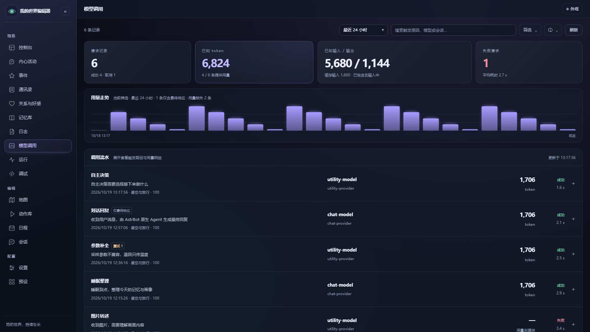

# 模型调用与 Token 用量

[文档目录](README.md) · [返回首页](../README.md)

在编辑器左侧打开 **模型调用**，或从 **日志 → 模型调用 ↗** 进入。这里用于回答：她什么时候调用了模型、为什么调用、用了哪个模型、返回了多少 Token。

## 怎样查看

顶部显示请求数量、已知 Token、输入与输出、失败次数和平均耗时。下方是用量走势与按时间倒序排列的调用流水。统计和走势覆盖当前筛选的全部记录，不局限于当前页。

可选择最近 24 小时、7 天或 30 天；搜索触发原因、模型、Provider 或会话标识。“筛选”菜单可进一步选择用途、会话、Provider 和结果，也可开启每 15 秒自动刷新。此页独立选择查看范围，不受顶栏的世界编辑范围限制。

展开一条记录，可查看：

- **触发路径**：例如“生活时钟推进 → 自主决策需要选择接下来做什么”，或“动作执行前补全工具参数”。
- **请求信息**：时间、会话、模型、Provider、结果和耗时。
- **用量明细**：输入、缓存输入、输出和总 Token；缓存已经包含在输入中，不能再次相加。
- **重试信息**：第几次尝试、重试原因和调用链 ID。同一条链里的多次请求可以相互对应。

页面处于后台，或正在展开查看详情时，自动刷新会暂缓。插件直接请求的失败和取消也会保留记录，便于找到重复尝试或配置问题。

## 哪些调用可以统计

| 调用路径 | 记录范围 |
| --- | --- |
| 插件直接请求模型 | 包含自主决策、生活与事件、日程、辅助判断、参数补全、记忆整理、图片转述、搜索阅读、内容生成等。每次请求单独记录，插件发起的重试也各占一条。 |
| AstrBot 原生聊天 | 记录本插件参与的聊天最终响应，标注“仅最终响应”。当前公开钩子不提供中间工具轮次、内部重试及其累计用量。 |
| 自动画像的工具循环 | 记录工具循环返回的最终响应，标注“仅最终响应”；中间轮次未计入。 |

这是本插件的观测记录。其他插件和 AstrBot 中没有经过这些入口的调用不会出现在这里。Provider 在一次请求内部自行重试时，插件通常也无法区分；原生请求若在最终响应钩子触发前中断，也可能没有记录。原生聊天的耗时表示本轮准备完毕后到收到最终响应的等待时间，可能包含工具执行。

## 怎样理解 Token

用量来自 Provider 返回的 `usage`，并非按文字长度估算。有些 Provider 不提供用量，此时显示 **— / 用量未提供**；失败或取消也可能已经产生消耗，但服务商未返回数据。

只返回部分字段时，页面保留已提供的数值，并在详情中说明；“已知 Token”可能仅包含已返回的部分。未提供的值不代表零。原生 Agent 与画像工具循环的中间轮次也未包含在汇总中，因此这里不能作为完整账单。费用以服务商账单为准。

## 保存与清理

记录存入插件自身的 SQLite 数据库，重启后仍在。保留最近 **30 天**，最多 **10,000 条**，每次写入时自动清理；查看范围最长为 30 天。

从启用此功能后开始记录，无法补回过去的调用。记录保存用途、触发路径、用量和排查所需的信息，不主动保存提示词、图片或回复正文；失败时保存经过常见凭据与请求地址脱敏、截短的错误信息。页面沿用编辑器的访问保护。
