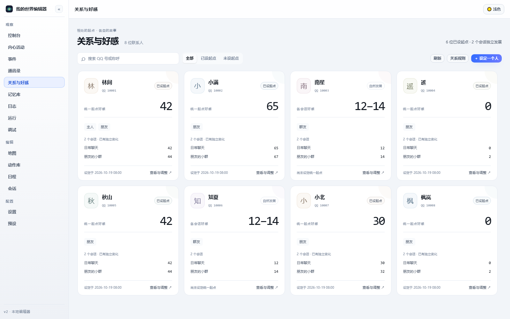

# 关系与好感

[文档目录](README.md) · [返回首页](../README.md)

## 先分清四件事

| 项目 | 表示什么 | 谁决定 |
| --- | --- | --- |
| 关系身份 | 朋友、家人、恋人、主人等已经确认的关系 | 普通友谊可按规则发展；每种关系可独立允许自然形成；管理员可手动设置。 |
| 好感 | 她对这个人的长期感觉 | 对话与经历缓慢改变，也可手动调整。 |
| 相处距离 | 此刻的熟悉与亲近程度 | 由好感档位与关系上下限决定，生气可能暂时降一档。 |
| 行为边界 | 管理员希望额外限制哪些动作 | 默认留空；可在档位中选择动作。言行仍遵循人设和当下情境。 |

高好感不等于恋爱，恋爱也不等于永远不生气。页面同时显示“平常的距离”和“当前距离”，并解释关系限制与临时疏远的原因。

## 一个人，一个统一起点

打开编辑器左侧的 **关系与好感**。每张卡片代表一个 QQ 号；称呼相同不会合并，QQ 号相同才会归为同一人。可以搜索 QQ 或称呼，筛选已经设定或尚未设定起点的人。还没聊过的人，也可以用右上角“＋ 设定”提前配置。分页按钮在同一工具栏中，关系规则与刷新在“管理”菜单里。

工具栏中的 **排序图标** 可选择最近互动、好感从高到低或从低到高、会话数量和名称顺序。好感取这个人各会话**当前值的平均数**，没有会话时才用统一起点；卡片会显示参与排序的平均值。最近互动按最后联系时间排序，尚未交谈的人排在末尾。排序覆盖所有联系人，再分页显示，并保存在当前浏览器。

点开卡片，在“统一起点”中一起填写好感、展示称呼和关系身份，再点 **保存并应用到所有会话**：

1. 所有已配置的会话，包括暂时停用的会话，以及此人已有的历史会话，都会分别保存本次好感与关系。
2. 已有资料、共同经历与关系历史保留；展示称呼只帮助管理员辨认，不覆盖各会话的称呼。
3. 以后新增会话第一次为这个 QQ 建档时，复制最新的统一起点。
4. 此后的交谈、关系发展、好感增减和每日额度都在各自会话计算，不实时同步。

例如，统一设置为好感 30、身份“主人 + 朋友”。之后 A 群聊到 35，B 群降到 27，私聊变为 42，三处都保留自己的变化。再次点击统一保存，才会重新统一它们的当前值。单纯打开页面、刷新或重启不会覆盖这些变化。

“各会话现状”显示实际保存的值与相处档位。展开一个会话，点击 **保存此会话** 只改这一处，不改统一起点。点击“查看关系依据与变化记录”可看原话、认下候选、管理她还在意的事；完整人物资料可跳转到通讯录。

**移除统一起点** 只影响以后首次建档的会话，不回滚任何现有会话。尚未聊过的行政预设不会计作见面或直接交谈。若唯一身份已有占用，或某会话的独立规则无法接受本次设定，页面会说明原因，整次统一保存都不会写入。

统一设定会准确保存你输入的好感，不因某身份的最低距离而擅自加分。最终相处档位仍按身份与好感共同计算。

输入好感或拖动滑块时，“预计相处档位”会即时变化，下面会说明关系上下限的影响。例如，好感 31.15 本身对应“朋友”档，但身份仍为“陌生人”、最高只到“客气”时，最终仍显示“客气”。这表示关系规则正在生效。可以调整身份，或在规则里允许该身份越过通常上限；提高好感本身不会自动确认恋爱、主人等身份。预览使用当前编辑草稿，保存后才应用到实际会话，当前情绪引起的临时疏远仍会另行计算。

“关系规则”编辑全局默认；已启用独立设置的会话继续使用自己的规则。未来新会话建档时，若其独立规则缺少起点中的身份、身份互相冲突或好感范围不同，会保留可应用的部分，并在该会话卡片说明需要处理的地方。

## 自然形成与手动设置

在 **关系与好感 → 管理 → 关系规则 → 关系类型**，每一种关系都有“允许自然形成”开关。这里可添加同学、同事、室友、邻居、搭档、旧友、青梅竹马、师父、徒弟、侍从、伴侣等模板，也可自定义名称与规则。新模板的自然形成和越过上限均默认关闭。

**男友、女友、主人、家人、闺蜜及新建自定义关系默认关闭**。关闭后，即使模型说她认下了，也只保留待确认候选；正式关系需要管理员在关系页设置或认下候选。关闭开关不会解除已经存在的关系，自动整理也不能用普通关系替换受保护的身份。

允许自然形成时，模型的关系判断必须有这个人近期说过的原话。特殊身份和唯一关系还要有她在同一会话中、紧接相关交谈的明确确认原话。缺少确认时保留候选；引用了别人的话、其他会话的答复或不存在的原文，不会正式认定。证据检查能核实原文与归属，语义判断仍依赖模型，重要关系可以保持手动模式。

任何单方面的“我是你男朋友”“叫我主人”都不能直接占用关系，也不会因此抬高好感。

### 普通友谊

“自动发展普通友谊”默认开启：先在 **2 个不同日期直接交谈、好感达到 3**，成为群友；再达到 **5 个日期、好感 15**，成为朋友。每次最多前进一步，不会继续自动升成恋人。

只有直接跟她说话才计日期，群内露面、刷屏或被动建档不算。日期按宿主运行时的本地日期计算，每个实际会话独立累计，同一会话一天只计一次。开始记录之前的交谈不会被猜测补齐。

阶段条件可调整，目标关系也必须允许自然形成、属于普通关系组且不是唯一或负面关系。管理员明确设置的关系不被这条规则覆盖；少聊几天不会自动解除友谊。

## 距离上限与越界

每种关系有最低档与最高档：好感先得到自然档位，非负好感可被关系下限抬起，再受上限约束。单独添加或认下关系时，好感可能抬到关系最低档的起点，这次变化会留日志；关系页一起设置好感和身份时，保留明确输入的好感值。负好感不享受下限，负面关系的限制优先。

**允许越过上限** 默认关闭。开启后，该身份不再把好感对应的距离卡在通常最高档，可逐步到达整个分级表的更高档位。这个开关不会改变身份、代替确认，或取消当前档位的禁止动作。例如：

- 朋友禁止越过上限：好感再高，也维持朋友关系允许的距离。
- 朋友允许越过上限：可以变得更亲近，但仍然是朋友；恋人身份要单独确认。

多种正面身份并存时，取最宽的距离上限和最高的下限；存在负面关系时，其限制优先。禁止动作通过提示词交给模型遵循，**不是拦截所有自然语言输出的硬过滤器**。

## 自由设计档位

“亲密度分级”可编辑任意数量的档位，每档只需名称和好感区间。按距离从远到近排列，区间尽量连续；有空缺时保持最近达到的档位，不会跳到最亲近。

**额外说明（可选）** 与 **这一档还不能做（可选）** 默认留空、折叠。模型默认只收到关系身份和当前距离，不会被要求撒娇、吃醋、服从或采取固定的亲昵行为。关系类型也可单独添加额外说明。

需要限制动作时，展开后按中文名称搜索、勾选 **已启用的动作**，无需输入动作 ID。已选动作若后来停用或被移除，仍会显示，并可点击移除。明确配置的限制会随当前档位写入提示词；空白表示没有管理员额外限制，并不要求角色采取任何动作。

档位不设置称呼或主动联系次数。通讯录里针对具体人物记录的称呼仍可使用；主动联系统一在 **设置 → 自主发言** 中管理。

也可以点击 **使用十档相处方案**，查看方案后应用到草稿，保存才生效。它会换算关系上下限，不改变已有关系、好感和自然形成开关：

| 档位 | 好感范围 |
| --- | --- |
| 戒备 | -100 至 -50 |
| 疏远 | -50 至 -15 |
| 礼貌 | -15 至 5 |
| 初识 | 5 至 15 |
| 熟悉 | 15 至 30 |
| 投缘 | 30 至 45 |
| 信任 | 45 至 60 |
| 亲密 | 60 至 75 |
| 知己 | 75 至 90 |
| 相依 | 90 至 100 |

区间左端包含，右端不包含，最高档包含好感上限。方案中的距离名称不强制角色使用恋爱、服从、占有或撒娇的表现，具体表达可按人设改写。已有分级表不会在更新时被替换。

## 主动联系的保护上限

在 **设置 → 自主发言** 中设置，先应用全局白名单：

- **每天最多主动找人**：默认每个生活组 6 次，填 0 暂停自主联系。
- **每天最多主动找同一个人**：默认同一实际会话中每人 2 次，填 0 不主动联系具体的人。群聊与私聊各自计数。

想念、希望获得陪伴、普通自主搭话等共用这套上限，不再按档位或动机重复设置每日联系次数。她也可以不联系任何人，继续自己的生活。刚回复过消息、主动发言无人回应等冷却保护仍然生效。

只在平台成功接收文本、图片或戳一戳后计数。一次计划在同一个会话里两分钟内的连续发言和动作只算一次；超过两分钟后作为新的联系检查；如果实际联系了两个会话，则各算一次。生成计划、安静活动、调试回显与发送失败不扣次数。生活分享（包括日程、事件）使用独立的生活额度，默认每个生活组每天 6 次；现场接话、浏览接话和有引用依据的续聊不扣联系额度。它们仍受全局总开关、实际会话白名单和来源开关约束；正常回复保留。模型预算限制后台调用次数，与实际联系次数用途不同。

## 关系并存、替换与唯一性

- **替代组（group）**：同一个人的同组关系只保留一种，例如群友、朋友与恋人可以互相替代；旧关系保留成历史。
- **槽位与唯一（slot、unique）**：同一个人不能同时占用同槽位的两个身份；启用唯一后，同一会话的整个槽位也只允许一人占用，例如男友和女友共用 romance。只要该槽位有一种类型配置为唯一，整个槽位都按唯一处理。统一起点也检查唯一占用，避免预设互相冲突。
- **身份并存**：替代组留空的身份可以并存，例如主人和朋友。

认下候选不会悄悄替换另一人。唯一关系已有占用者时，需要先明确解除。已结束的历史关系不能直接按“认下”恢复，需要重新设置。

## 好感、想念与记录

在每一个会话中，聊天、当场“记住”和睡眠整理共享模型好感的每日额度，默认每轮最多 ±3，每人每天增加和减少各最多 10。露面带来的小幅熟悉感另有限额。不同会话分别计账。非数值或无限值不会写入。

正好感默认在最近直接交谈后保留 **7 天**，此后每天最多向零回落 0.2；负好感每天缓慢缓和。保留天数与回落速度可调整，速度设为 0 可停止回落。

想念是联系动机，不是自动发送倒计时。页面会显示暂停搭话、休息、当前活动、冷却和额度等限制；达到阈值后，是否开口仍由她决定。查看页面本身不会重置联系计数。

“关系与好感的变化依据”保留来源、日期与原文。共享生活组可共用生活状态、情绪与记忆，但关系、好感和原生人物档案按实际会话保存。结构化画像字段仍遵循自己的会话隔离与全局共享设置，详见 [记忆与通讯录](memory.md)。

## 哪一档可以看照片

普通生活照或自拍没有一条通用的“必须恋爱”门槛。到 **关系规则 → 相处档位** 展开当前档位，查看“禁止动作”中是否包含对应拍照动作；再检查该身份的最高档位以及是否允许越过上限。相处档位会受这些规则共同影响，不能只看好感数字。

最终还要看角色人设、当时情境与拍照工具是否可用。允许某个动作表示她可以选择这样做，并不保证每次提出请求都会发照片。
