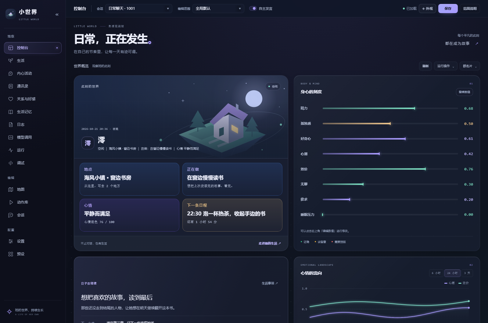
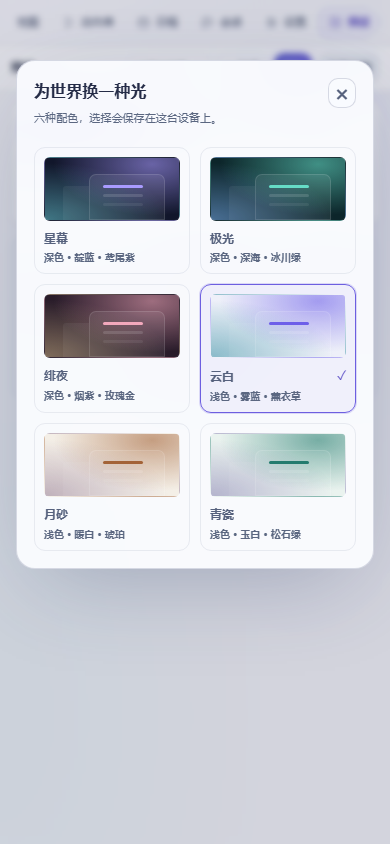

# 编辑器与外观

[文档目录](README.md) · [返回首页](../README.md)

从 AstrBot 插件管理打开“小世界”。左侧选择页面，顶栏选择会话或编辑范围；主要区域用于查看资料、记录与世界内容。手机上的导航位于顶部，可左右滑动，会话、编辑范围与自主搭话位于“会话与范围”菜单；通讯录的群聊选择仍直接显示。

控制台以“生活观测站”为中心：世界视窗与身心刻度、牵挂与心情曲线、下一步与聊天现场逐行对齐。四格展示地点、活动、心情、日程，以及真实动作进度和背景。“世界怎样运转”横跨整行，分为时间、动作、联系三栏；预算与通道状态收在第二层诊断中。

生活的“经历”将雷达与四张能力卡放在一起，显示生活积累出的真实能力值。“周视图”按屏幕宽度分四、三、二或一列阅读，超宽屏可看七天，日历和日记正文不再缩成小字，长日记可以继续展开。

设置中的“自主发言”集中管理全局白名单、参与方式和保护限额；细节按决策、现场、退避、预算和主动了解分组折叠。授权通过“应用全局白名单”立即保存，其他行为设置使用顶栏保存。

世界视窗是随主题变化的装饰性矢量插画，文字来自当前会话状态；插画不会表示角色已经搬家或执行了某项动作。

v4.34.4 将控制台四张概览卡片恢复为 v4.34.0 的蓝、紫、金渐变、标签与边框效果，布局和顺序保持原样。切换会话或趋势时段后，旧请求不会覆盖当前视图；后台刷新也会保留正在输入的群名片。

侧栏默认在较窄的桌面窗口收成图标栏。点击品牌旁的箭头可展开或收起，你的选择会保存在当前浏览器；收起后悬停图标可看页面名称。

## 选择外观

点击右上角 **◈ 外观**，直接选择配色，即时查看效果。按 Esc、点击空白处或关闭按钮即可返回。选择保存在当前浏览器，不会修改角色设置，也不会影响其他人的设备。

| 深色 | 浅色 |
| --- | --- |
| 星屿：星轨、靛蓝与冷光玻璃 | 晴空：云层、雾蓝与轻盈透光 |
| 潮汐：极光、深海流线与青绿 | 日晷：刻度、暖白与温润纸感 |
| 晚樱：花影、暖夜与缎面光泽 | 竹间：竹影、玉白与青瓷釉面 |

浅色适合明亮环境，深色适合夜间。每套主题独立调整背景纹理、插画、边缘与部分文字质感。桌面世界视窗有轻微悬浮与指针景深；开启系统“减少动态效果”后，移动和过渡会停用。插画、图标和主题均在本地加载，无需远程图片或字体服务。

## 工具在哪里

| 页面 | 常用入口 | 其他操作 |
| --- | --- | --- |
| 通讯录 | 顶栏选群，工具栏搜索、筛选与排序图标，点卡片打开档案 | “通讯录”视图菜单可切到总览、审计和数据与备份；“管理”中整理资料、查看会话或清空。 |
| 关系与好感 | 搜索 QQ 或称呼，筛选起点状态，用排序图标排列人物，点卡片查看与调整 | 翻页在工具栏，“＋ 设定”可提前配置一个 QQ；“管理”中刷新与编辑关系规则。 |
| 动作库 | 搜索、分组、新增、生成 | “筛选与视图”中选择排序、卡片或列表、批量选择；“高级”中管理默认动作与 JSON。 |
| 记忆库、日志 | 会话、关键词与常用筛选 | 导出、全选、删除等位于“批量管理”；操作说明在“说明”中。 |
| 模型调用 | 时间、搜索与调用流水，点记录查看触发路径和 Token 明细 | “筛选”中选择用途、会话、Provider、结果及自动刷新；ⓘ 中说明统计范围。 |
| 控制台 | 查看她的位置、活动、数值和计划 | “运行操作”中手动推进、决策、打断或叫醒。 |
| 设置 | 分类导航、搜索设置项 | 顶栏选择编辑范围，“范围说明”解释继承与本页独立配置。 |

菜单点击外部或按 Esc 关闭；人物档案以抽屉打开，关闭后返回原来选择的卡片。工具区保持紧凑，卡片列表独立滚动。

通讯录可按当前会话的最近联系、好感升降、称呼、交谈次数或画像完整度排序。关系页可按最近互动、各会话平均好感升降、会话数量或名称排序；尚无会话时，好感排序使用统一起点。两个页面分别记住你的排序选择，只保存在当前浏览器。

## 人物卡片怎么读

通讯录展示她记得的称呼、偏好与共同经历。资料摘要用于快速浏览，完整字段和证据在档案抽屉中。

关系卡上的大数字表示统一起点好感，或各会话当前好感的范围。细轨道上的标记对应这些数值，小刻线表示零；它不是“恋爱进度”。下面列出身份与部分会话现状，更多信息可展开查看。

人物色调用于区分卡片，不表示关系高低。是否已设统一起点会通过文字标明。关系规则、保存范围和独立发展方式见 [关系与好感](relationships.md)。

本页截图使用合成人物与示例资料。

模型调用记录的用途、Token 含义与覆盖范围，见 [模型调用与用量](model-calls.md)。

“生活”入口分为今日、牵挂、经历和周视图。今日展示安排、节奏依据与最近经历；周视图把七天日程、现实或虚构世界日历与每日日记放在同一条时间线上；日程和事件的完整编辑放在管理抽屉，抽屉内可选择编辑范围并保存。详见 [生活工作区](life-workspace.md)。

生活页顶栏的 **手机与电脑** 直接设置安静翻消息的设备、来源与读取量，在三个视图都可打开。“牵挂”以卡片展示动机、下一步与实际步骤进度；历史、依据和管理进入侧边抽屉。顶部“···”收纳生活积累、用量、节奏与预算，支持按进度或时间排序。控制台也会提示此刻惦记的事项。使用规则见 [生活事项与持续推进](life-matters.md)。
